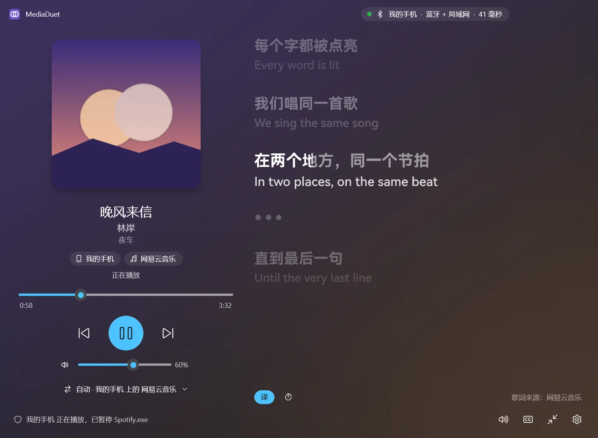
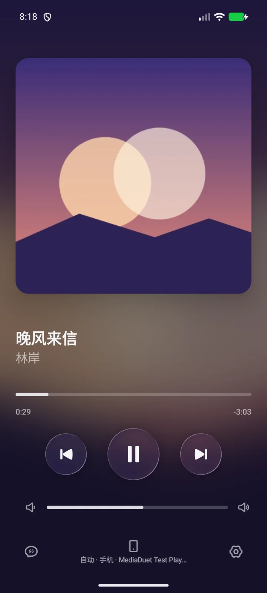

<p align="center"></p>

<h1 align="center">MediaDuet</h1>
<p align="center"><strong>电脑控制手机音乐，手机遥控电脑播放。</strong><br>
跨设备切歌、自动暂停与恢复、同步歌词。</p>

<p align="center">
  <a href="https://github.com/TIANLI0/MediaDuet/releases/latest"><strong>下载</strong></a> ·
  <a href="#快速开始">快速开始</a> ·
  <a href="docs/usage.md">使用指南</a> ·
  <a href="https://tianli0.github.io/MediaDuet/">官网</a> ·
  <a href="README.en.md">English</a>
</p>

MediaDuet 把电脑和手机上的播放控制连在一起。你仍然用熟悉的音乐或视频 App 播放，在另一台设备上就能查看歌曲、暂停、切歌和调节音量。

例如，**手机连着耳机听歌，人在电脑前工作**：不用拿起手机就能切歌；电脑开始播放视频或游戏声音时，手机音乐自动暂停，电脑安静后再恢复。

## 能做什么

| 你想做的事 | MediaDuet 提供的功能 |
| --- | --- |
| 不拿手机，也能切歌 | 电脑控制手机播放，手机也能反过来控制电脑；显示歌名、封面和进度 |
| 避免电脑和手机同时响 | 按优先级自动暂停、恢复播放；手动暂停的音乐会保持暂停 |
| 随时看到歌词 | 两端同步歌词、逐字高亮和译文；Windows 另有桌面歌词、任务栏歌词 |
| 换台设备接着听 | 将歌曲交给另一端的网易云音乐、QQ 音乐或 Spotify，尝试从当前进度继续播放 |
| 只用本机控制和歌词 | 选择“仅此电脑”或“仅此手机”，无需配对 |

**远程控制时，声音默认仍从原设备输出。** “接力播放”是在另一台设备的播放器里打开歌曲；“音频传输”才是把声音传过去。这些功能可以分别使用，详见[使用指南](docs/usage.md)。

## 界面预览

<table>
  <tr>
    <th>Windows：播放控制与同步歌词</th>
    <th>Android：查看和控制播放</th>
  </tr>
  <tr>
    <td></td>
    <td></td>
  </tr>
</table>

## 下载

在 [Releases 下载页面](https://github.com/TIANLI0/MediaDuet/releases/latest)选择对应文件，电脑和手机尽量使用同一版本。

| 设备 | 系统要求 | 下载文件 |
| --- | --- | --- |
| Windows 电脑 | Windows 10 2004+ / Windows 11，x64 | 安装版 `MediaDuet-<版本>-x64-setup.exe`，或免安装版 `MediaDuet-<版本>-win-x64.zip` |
| Android 手机 | Android 10+，64 位 ARM | `MediaDuet-<版本>-android.apk` |

Windows 免安装版需要**完整解压**后运行 `MediaDuet.exe`；Android 安装 APK 后打开即可。Windows 10 和部分 Android 版本尚待真机验证，已验证环境见[兼容性列表](docs/compatibility.md)。

## 快速开始

下面以**同一局域网连接**为例。电脑连网线、手机连同一路由器的 Wi-Fi 也可以。

### 1. 打开两端，选择搭配使用

首次启动时，选择搭配另一台设备使用。只需要本机播放控制和歌词时，选择“仅此电脑 / 仅此手机”，无需继续配对。

### 2. 在手机上授权

打开手机端 **设置 → 权限与后台**，按页面提示开启通知使用权、所需连接权限，并允许后台运行。

“通知使用权”用于获取和控制播放器的媒体会话，MediaDuet 不读取、保存或发送通知正文。若系统禁止授权，先在系统 **应用信息 → 右上角菜单 → 允许受限设置**中放行，再返回授权。

### 3. 配对电脑和手机

1. 手机端：打开 **设置 → 连接 → 配对模式**，配对窗口有效期为 5 分钟。
2. 电脑端：打开 **设置 → 设备与配对 → 配对新手机**，选择发现的手机。
3. 核对两端显示的 **6 位配对码**，确认一致后在两端确认。

没有发现手机？在电脑端选择 **“通过 IP 地址连接”**，填写手机 App 显示的地址和端口（默认 `47321`）。也可以[通过蓝牙连接](docs/usage.md#通过蓝牙连接)。

### 4. 播放一首歌，试试切歌

在手机原来的音乐 App 中播放歌曲，电脑端应出现歌名、封面和进度。试着暂停或切歌；用手机控制电脑时，则先在电脑上开始播放。

连接成功但看不到歌曲、锁屏后断开等问题，见[连接与播放问题](docs/usage.md#连接与播放问题)。

## 接下来可以试试

- **自动暂停与恢复**：在电脑端 **设置 → 播放仲裁**中选择电脑优先、手机优先等行为。[设置说明](docs/usage.md#自动暂停与恢复)
- **歌词**：使用 Windows 桌面歌词、任务栏歌词，或开启 Android 歌词通知，在锁屏上看当前歌词；Android 16 实时通知、ColorOS 16 流体云的显示取决于系统支持。[歌词说明](docs/usage.md#歌词与本机模式)
- **换设备继续听**：使用“在手机上继续 / 在电脑上继续”。接力效果取决于播放器、曲库和账号权限，部分适配尚待真机验证。[接力说明](docs/usage.md#在另一台设备上继续听)
- **让手机声音从电脑播放**：开启“接收手机音频”，需要系统蓝牙配对，兼容性尚待真机验证。电脑声音传到手机目前为实验功能。[音频说明](docs/usage.md#把声音传到另一台设备)

关闭电脑窗口后，MediaDuet 会留在系统托盘继续运行；完全退出请使用托盘菜单。

## 隐私与联网

无需注册 MediaDuet 账号。设备通过局域网或蓝牙直接连接，通信加密，无需云端转发。

在线歌词、高清封面、接力查歌和更新需要访问外网；歌曲查询会使用歌名、歌手等歌曲信息。在线歌词源、高清封面查询和自动更新检查可在设置中关闭。详见[隐私与联网说明](docs/usage.md#隐私与联网)。

## 开发

Windows 使用 C++20 / WinUI 3，Android 使用 Kotlin / Jetpack Compose。普通用户下载发布版即可；开发者可从下面的构建命令开始。

<details>
<summary>展开源码构建与测试命令</summary>

### Windows

需要 Visual Studio 2022 / 2026 的 C++ 和 WinUI 开发工具、Windows SDK、CMake 3.24+、Ninja。生成安装包还需 NSIS 3。

在仓库根目录运行，构建主程序和界面、运行核心测试，并生成 `dist/` 下的免安装包；已安装 NSIS 时还会生成安装程序：

```powershell
powershell -ExecutionPolicy Bypass -File windows\packaging\package.ps1 -Arch x64
```

仅构建主程序并运行核心测试（在 Visual Studio Developer PowerShell 中）：

```powershell
cmake -S windows -B windows/build -G Ninja -DCMAKE_BUILD_TYPE=Release
cmake --build windows/build
ctest --test-dir windows/build --output-on-failure
```

单独构建界面：

```powershell
msbuild windows\ui\MediaDuetUI.vcxproj -restore -p:Configuration=Release -p:Platform=x64
```

更多界面构建、调试与测试方法见 [Windows 界面文档](windows/ui/README.md)。

### Android

需要 JDK 21、Android SDK 37。在仓库根目录的 Windows PowerShell 中运行：

```powershell
cd android
.\gradlew.bat :app:assembleDebug :app:testDebugUnitTest :app:lintDebug
```

macOS / Linux 使用 `./gradlew`。Debug APK 位于 `android/app/build/outputs/apk/debug/`。发布构建和签名配置见 [Android 文档](android/README.md)；未配置签名时，Release APK 不会签名。

</details>

| 文档 | 内容 |
| --- | --- |
| [架构与目录](docs/architecture.md) | 两端技术结构与模块职责 |
| [通信协议](protocol/specification.md) · [连接机制](docs/bluetooth.md) | 配对、加密、蓝牙与局域网连接 |
| [兼容性](docs/compatibility.md) · [测试记录](docs/testing.md) | 已验证环境、功能限制和待验证项目 |
| [Windows 界面开发](windows/ui/README.md) · [Android 开发](android/README.md) | 各端构建、调试与测试 |

## 许可

[MIT](LICENSE) © 2026 tianli。第三方组件使用各自的许可，详见[第三方许可说明](docs/THIRD_PARTY_NOTICES.md)。随附的 HarmonyOS Sans 字体遵循其字体许可，不属于 MIT 许可范围。
